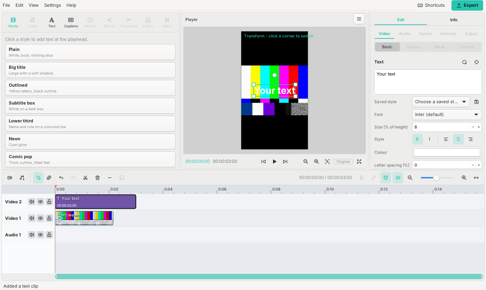
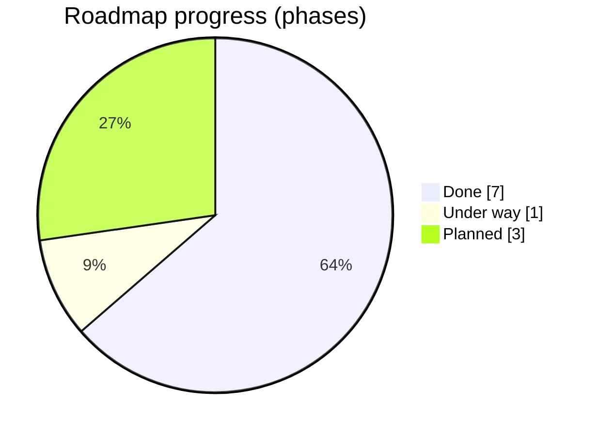
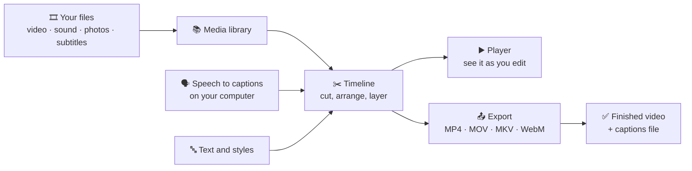
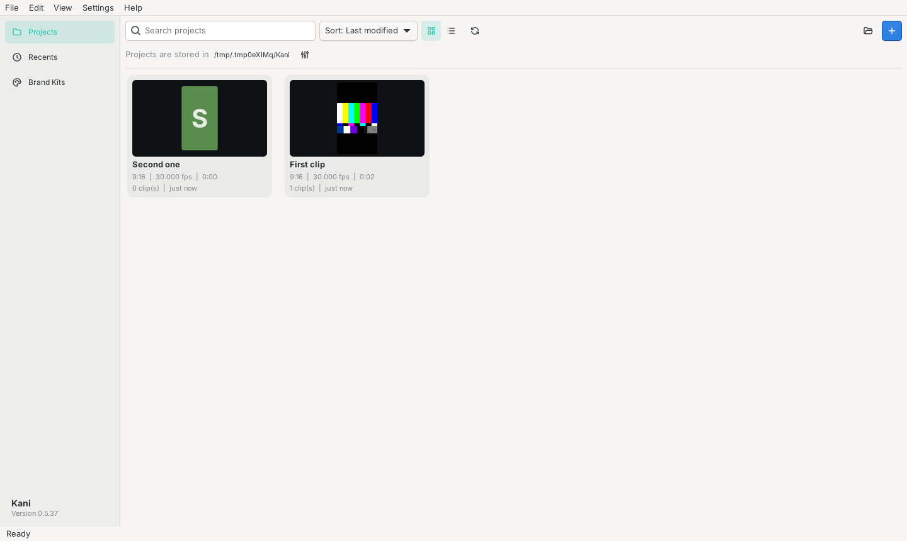

<p align="center">
  
</p>

<h1 align="center">Kani</h1>

<p align="center"><em>Time-bending edits made simple.</em></p>

<p align="center">
  
  
  
  
  
</p>

Kani is a free video editor for short videos (Reels, Shorts, TikToks), in the spirit of CapCut but built from
scratch. Everything runs on your own computer: no account, no cloud, no uploads. Even the automatic captions are made
on your machine.

<p align="center">
  
</p>

## Where things stand

**7 of 11 phases are done**, one is under way, and three are still to come. Kani already edits, adds text and captions,
and exports finished videos on Linux. Windows is being tested on a second machine.

| | Phase | What it gives you | Status |
|---:|---|---|---|
| 1 | Foundations | The timeline, project folders, undo | ✅ Done |
| 2 | The app | Home screen, editing, saving, settings | ✅ Done |
| 3 | Your media | Importing video, sound and photos; playing them back; using the graphics chip to decode | ✅ Done on Linux · 🟡 checking on Windows |
| 4 | Layers | Stacking clips, moving, scaling, turning, fading, keyframes | ✅ Done |
| 5 | Export | Saving the finished video (MP4, MOV, MKV, WebM; H.264 to AV1), fast with the graphics chip | ✅ Done on Linux · 🟡 checking on Windows |
| 6 | Text | Text with fonts, outlines, shadows, warps; saved styles | ✅ Done |
| 7 | Captions | Automatic captions from speech, word-by-word highlighting, subtitle files in and out | ✅ Done |
| 8 | Libraries | Ready-made assets and Brand Kits (your logo, fonts, colours) | ⬜ Planned |
| 9 | Colour | Colour looks (LUTs) and basic grading | ⬜ Planned |
| 10 | Stickers | Animated and still stickers | ⬜ Planned |
| 11 | Ready to share | Installers for Windows, Linux and Mac | 🟡 Started (Windows package, safe mode) |



## The roadmap

```mermaid
flowchart LR
    P1["1 · Foundations"]:::done --> P2["2 · The app"]:::done --> P3["3 · Your media"]:::done --> P4["4 · Layers"]:::done
    P4 --> P5["5 · Export"]:::done --> P6["6 · Text"]:::done --> P7["7 · Captions"]:::done
    P7 --> P11["11 · Ready to share"]:::now
    P7 --> P8["8 · Libraries"]:::later --> P9["9 · Colour"]:::later --> P10["10 · Stickers"]:::later --> P11
    classDef done fill:#2ea44f,color:#fff,stroke:#22863a
    classDef now fill:#d29922,color:#fff,stroke:#9e6a03
    classDef later fill:#eaeef2,color:#57606a,stroke:#d0d7de
```



Green is done, amber is in progress, grey is next. Phases 3 and 5 still have Windows checks open; their list is in
[the Windows checkpoint](docs/WINDOWS_CHECKPOINT.md). Phases 8 to 10 start when Tako gives the go-ahead.

## How Kani works



## What you can do today

- **Start projects** from the home screen, with every shape: vertical 9:16, square, wide 16:9, 4K or your own size.
  Each project card shows its last picture.
- **Bring in media** by dragging files in, pasting, or importing. Kani reads almost any video, and can make small
  stand-in copies (proxies) so big files edit smoothly.
- **Edit on the timeline**: cut, trim, move, copy and paste, replace a clip by dropping a file on it, and undo
  anything. Tracks can be renamed, rearranged and added anywhere.
- **Layer and animate**: move, scale, turn, fade, warp and pin clips, with keyframes for animation. Rulers, a grid and
  guides help line things up, and pictures snap to them.
- **Add text** in many looks, and save your own styles to reuse.
- **Make captions automatically** from what is said, with the spoken word lighting up, or import an `.srt`, `.vtt`
  or `.ass` file.
- **Export** finished videos with presets for YouTube, TikTok, Instagram and more, using the graphics chip to go
  faster. The time it took is shown at the end.

<table>
  <tr>
    <td></td>
    <td></td>
  </tr>
  <tr>
    <td align="center">Home screen: your projects, with their last picture</td>
    <td align="center">Captions: made from speech on your own computer</td>
  </tr>
</table>

## Latest changes

| Build | What changed |
|---:|---|
| 73 | On Windows, Kani keeps its own files beside the program instead of in AppData. |
| 72 | A ready-to-run Windows folder with everything included; a start-up log; automatic safe mode after a crash. |
| 71 | Project cards show the project's last picture. |
| 70 | Fixed: no sound in the preview on Windows. |
| 68 | Rename and rearrange tracks, snapping to guides, importing subtitle files, one consistent look. |

Every build is listed in plain words in the [changelog](docs/CHANGELOG.md).

## Try it

**On Linux** (Arch / CachyOS shown; Ubuntu and others are in the [full guide](docs/GUIDE.md#build-and-run)):

```
sudo pacman -S --needed base-devel cmake clang pkgconf gtk4 gstreamer gst-plugins-base gst-plugins-good gst-plugins-bad gst-libav gst-plugin-va
cargo run -p cutroom-gtk --release
```

**On Windows** (still being tested): build with `cargo build --release -p cutroom-gtk`, then run
`powershell -ExecutionPolicy Bypass -File tools\windows\package.ps1`. That makes a `dist\Kani` folder with everything
included; start `dist\Kani\bin\kani.exe`. Details are in the [full guide](docs/GUIDE.md#windows).

## Good to know

- Everything stays on your computer. Projects are ordinary folders you choose (by default `Documents/Kani`).
- If Kani ever closes badly, it starts in **safe mode** the next time, without the graphics chip, and says so.
- Some menu entries are greyed out: they belong to phases that are not built yet.
- Kani is a clean-room project: no CapCut code, artwork or templates are used ([how](docs/CLEAN_ROOM.md)).

## More reading

| Page | For |
|---|---|
| [Full guide](docs/GUIDE.md) | Every feature, shortcut and setting in detail, and building Kani yourself |
| [Changelog](docs/CHANGELOG.md) | Every build in plain words |
| [Settings](docs/SETTINGS.md) | What each setting does |
| [Windows checkpoint](docs/WINDOWS_CHECKPOINT.md) | What works on Windows and what is still being checked |
| [Interface style](docs/UI_STYLE.md) | The sizes and spacing every screen follows |

## License

Kani is free software under the [GPL-3.0-or-later](LICENSE). The crab logo was hand-drawn by znraznra. The Inter
typeface (SIL Open Font License) and Tabler icons (MIT) are bundled; see Help > About in the app for all credits.

*This page is updated with every change to Kani.*
